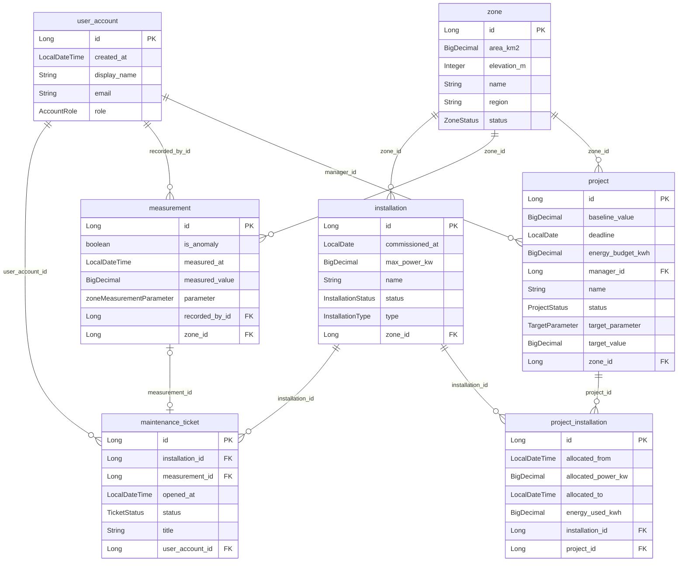

# Schemat bazy danych

Plik generują reguły projektu (panel Maven → Lifecycle → verify). Nie edytujcie go ręcznie.

Tabele: 7 · kolumny: 49 · relacje: 9 × @ManyToOne, 2 × @OneToMany, 1 × @OneToOne, 0 × @ManyToMany

| Tabela | Encja | Kolumny | Klucze obce |
|---|---|---|---|
| installation | Installation | 7 | zone_id |
| maintenance_ticket | MaintenanceTicket | 7 | installation_id, measurement_id, user_account_id |
| measurement | Measurement | 7 | recorded_by_id, zone_id |
| project | Project | 10 | manager_id, zone_id |
| project_installation | ProjectInstallation | 7 | installation_id, project_id |
| user_account | UserAccount | 5 | — |
| zone | Zone | 6 | — |

